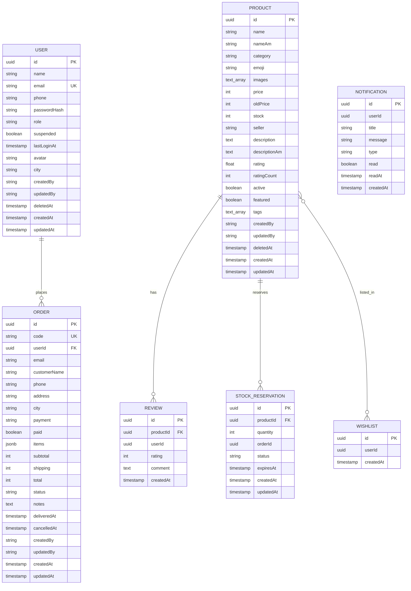

# Design Document: Code Cleanup and Database Fixes

## Overview

This design addresses comprehensive cleanup and fixes for the NileMart backend microservices platform. The system currently has critical issues that prevent production readiness, including inconsistent database configuration, missing validation, weak security practices, and poor error handling. This design provides a technical architecture for fixing 14 major areas:

1. **Database Configuration**: Unified configuration with schema auto-creation and proper connection management
2. **Request Validation**: DTO-based validation using class-validator across all endpoints
3. **Data Integrity**: Foreign keys, relationships, indexes, and soft deletes
4. **Error Handling**: RPC-to-HTTP exception mapping with structured error responses
5. **Security**: Password policies, rate limiting, JWT validation, SQL injection protection
6. **Service Communication**: Circuit breakers, correlation IDs, health checks
7. **Code Quality**: TypeScript strict typing, structured logging, constants extraction
8. **API Documentation**: OpenAPI/Swagger integration
9. **Migrations**: Migration-based schema management instead of synchronize
10. **Monitoring**: Prometheus metrics and structured logging
11. **CORS and Request Handling**: Proper CORS, compression, security headers
12. **Stock Compensation**: Automatic release for failed orders
13. **Soft Delete**: Preservation of deleted records with query exclusion
14. **Testing Infrastructure**: Jest setup with unit and integration tests

The design maintains the existing microservices architecture (API Gateway + 4 services) with TCP-based RPC communication, TypeORM entities, and PostgreSQL database with schema-per-service approach.

## Architecture

### Current Architecture

```
┌─────────────────┐
│   API Gateway   │  Port 4000 (HTTP)
│   (REST API)    │  Port 4010 (TCP RPC)
└────────┬────────┘
         │ TCP RPC
    ┌────┴────┬────────┬────────┐
    │         │        │        │
┌───▼───┐ ┌──▼──┐ ┌───▼───┐ ┌──▼────┐
│ Auth  │ │Catalog│ │ Order │ │Notify │
│ :4001 │ │ :4002 │ │ :4003 │ │ :4004 │
└───┬───┘ └──┬───┘ └───┬───┘ └───┬───┘
    │        │         │         │
    └────────┴─────────┴─────────┘
              │
     ┌────────▼─────────┐
     │   PostgreSQL     │
     │   Database:      │
     │   nilemart       │
     │                  │
     │  Schemas:        │
     │  - auth          │
     │  - catalog       │
     │  - orders        │
     │  - notify        │
     └──────────────────┘
```

### Database Architecture Changes

**Current Issue**: Mixed configuration approach with .env.example showing per-service databases but db.ts using single database with schemas.

**Design Decision**: Use single database with schemas (current db.ts approach) as it's simpler for development and already partially implemented.

```
Database: nilemart
├── Schema: auth
│   └── Table: users
├── Schema: catalog
│   ├── Table: products
│   ├── Table: reviews
│   ├── Table: wishlists
│   └── Table: stock_reservations (new)
├── Schema: orders
│   └── Table: orders
└── Schema: notify
    └── Table: notifications
```

### Key Design Changes

1. **Database Configuration Module**: Create `DatabaseConfigService` that:
   - Validates environment variables on startup
   - Creates schemas automatically via raw SQL
   - Configures connection pooling
   - Implements retry logic with exponential backoff
   - Switches between sync (dev) and migrations (prod)

2. **Validation Layer**: Create DTOs for all requests:
   - `RegisterDto`, `LoginDto` (auth)
   - `CreateProductDto`, `UpdateProductDto` (catalog)
   - `CreateOrderDto` (orders)
   - Global ValidationPipe with whitelist and forbidNonWhitelisted

3. **Error Handling Pipeline**:
   - `RpcExceptionFilter` in services: converts errors to RPC exceptions
   - `HttpExceptionFilter` in gateway: converts RPC exceptions to HTTP
   - Standardized error format with correlation IDs

4. **Security Middleware Stack**:
   - `AuthGuard`: JWT validation
   - `RateLimitGuard`: IP-based rate limiting with in-memory store
   - `PasswordPolicy`: validation service for password complexity
   - `SqlSanitizer`: input sanitization utility

5. **Observability Layer**:
   - `LoggerService`: structured logging with correlation IDs
   - `MetricsService`: Prometheus metrics collection
   - `HealthController`: health check endpoints
   - `TracingInterceptor`: request/response correlation

## Components and Interfaces

### 1. Database Configuration Service

**Location**: `libs/common/src/database/database-config.service.ts`

```typescript
interface DatabaseConfig {
  type: 'postgres';
  host: string;
  port: number;
  username: string;
  password: string;
  database: string;
  schema: string;
  entities: string[];
  migrations: string[];
  migrationsRun: boolean;
  synchronize: boolean;
  logging: LogLevel[];
  poolSize: number;
  maxQueryExecutionTime: number;
  retryAttempts: number;
  retryDelay: number;
}

class DatabaseConfigService {
  constructor(private readonly schema: string) {}
  
  async ensureSchema(): Promise<void>;
  createTypeOrmOptions(): TypeOrmModuleOptions;
  validateEnvVars(): void;
}
```

**Responsibilities**:
- Validate all DB_* environment variables are set
- Create schema if not exists using raw SQL query
- Return TypeORM configuration with proper types
- Switch synchronize off in production (NODE_ENV=production)
- Configure connection pool (min: 5, max: 20)
- Set up retry logic (5 attempts, exponential backoff starting at 1000ms)

### 2. Validation DTOs

**Location**: `apps/api-gateway/src/dto/*.dto.ts`

```typescript
// RegisterDto
class RegisterDto {
  @IsString()
  @IsNotEmpty()
  @MaxLength(100)
  @Transform(({ value }) => value?.trim())
  name: string;

  @IsEmail()
  @Transform(({ value }) => value?.toLowerCase())
  email: string;

  @IsString()
  @Matches(/^(\+251|0)[79]\d{8}$/)
  phone: string;

  @IsString()
  @MinLength(8)
  @Matches(/^(?=.*[a-z])(?=.*[A-Z])(?=.*\d)(?=.*[@$!%*?&])[A-Za-z\d@$!%*?&]/)
  password: string;

  @IsOptional()
  @IsEnum(['customer', 'admin'])
  role?: Role;

  @IsOptional()
  @IsString()
  adminCode?: string;
}

// CreateProductDto
class CreateProductDto {
  @IsString()
  @IsNotEmpty()
  @MaxLength(200)
  @Transform(({ value }) => value?.trim())
  name: string;

  @IsString()
  @IsNotEmpty()
  category: string;

  @IsNumber()
  @Min(0)
  price: number;

  @IsInt()
  @Min(0)
  stock: number;

  @IsOptional()
  @IsArray()
  @IsUrl({}, { each: true })
  images?: string[];

  @IsOptional()
  @IsString()
  description?: string;
}

// CreateOrderDto
class CreateOrderDto {
  @IsArray()
  @ArrayMinSize(1)
  @ValidateNested({ each: true })
  @Type(() => OrderItemDto)
  items: OrderItemDto[];

  @IsString()
  @IsIn(Object.keys(CITIES))
  city: string;

  @IsEnum(['telebirr', 'cbe', 'chapa', 'cod'])
  payment: PaymentMethod;

  @IsString()
  @IsNotEmpty()
  @MaxLength(100)
  customerName: string;

  @IsString()
  @IsNotEmpty()
  phone: string;

  @IsString()
  @IsNotEmpty()
  @MaxLength(500)
  address: string;

  @IsOptional()
  @IsString()
  @MaxLength(1000)
  notes?: string;
}

class OrderItemDto {
  @IsUUID()
  productId: string;

  @IsInt()
  @Min(1)
  qty: number;
}
```

**Key Features**:
- `@Transform` for sanitization (trim, toLowerCase)
- Regex validation for phone and password
- Nested validation for order items
- Custom validators for Ethiopian phone format
- WhitelistValidationPipe to reject extra fields

### 3. Error Handling Filters

**Location**: `apps/api-gateway/src/core/filters/`

```typescript
// HttpExceptionFilter (enhanced)
@Catch()
class GlobalHttpExceptionFilter implements ExceptionFilter {
  catch(exception: unknown, host: ArgumentsHost): void;
  private mapRpcToHttp(rpcError: any): HttpException;
  private createErrorResponse(
    status: number,
    message: string,
    path: string,
    correlationId?: string
  ): ErrorResponse;
}

interface ErrorResponse {
  statusCode: number;
  message: string | string[];
  error: string;
  timestamp: string; // ISO8601
  path: string;
  correlationId?: string;
}

// RPC Exception Mapper
class RpcExceptionMapper {
  static toHttp(rpcException: RpcException): HttpException {
    const error = rpcException.getError();
    const status = typeof error === 'object' && 'status' in error
      ? error.status
      : HttpStatus.INTERNAL_SERVER_ERROR;
    
    const message = typeof error === 'object' && 'message' in error
      ? error.message
      : 'Internal server error';
    
    return new HttpException(message, status);
  }
}
```

**RPC to HTTP Status Mapping**:
- 400 (Bad Request): Validation errors
- 401 (Unauthorized): Authentication required
- 403 (Forbidden): Insufficient permissions
- 404 (Not Found): Resource not found
- 409 (Conflict): Duplicate resource
- 500 (Internal Server Error): Unhandled errors
- 503 (Service Unavailable): Service down/timeout
- 504 (Gateway Timeout): RPC timeout exceeded

### 4. Security Components

**Location**: `libs/common/src/security/`

```typescript
// PasswordPolicyService
class PasswordPolicyService {
  validate(password: string): ValidationResult;
  hash(password: string): Promise<string>; // bcrypt with cost 12
  compare(plain: string, hash: string): Promise<boolean>;
}

interface ValidationResult {
  valid: boolean;
  errors: string[];
}

// RateLimitGuard
@Injectable()
class RateLimitGuard implements CanActivate {
  private store: Map<string, RateLimitEntry> = new Map();
  
  canActivate(context: ExecutionContext): boolean;
  private getClientIp(request: Request): string;
  private checkLimit(ip: string, limit: number, windowMs: number): boolean;
}

interface RateLimitEntry {
  count: number;
  resetAt: number;
}

// Rate limits
const RATE_LIMITS = {
  AUTH_ENDPOINTS: { limit: 20, windowMs: 60000 }, // 20/min
  AUTHENTICATED: { limit: 100, windowMs: 60000 }, // 100/min
};

// SQL Sanitization Utility
class SqlSanitizer {
  static sanitize(input: string): string {
    return input
      .trim()
      .replace(/['";\\]/g, '') // Remove SQL special chars
      .slice(0, 1000); // Max length
  }
}

// JWT Environment Validator
class JwtValidator {
  static validate(): void {
    const secret = process.env.JWT_SECRET;
    if (!secret || secret.length < 32) {
      throw new Error('JWT_SECRET must be at least 32 characters');
    }
    if (secret === 'change-me-to-a-long-random-string') {
      throw new Error('JWT_SECRET must be changed from default');
    }
  }
}

// Account Lockout Service
class AccountLockoutService {
  private attempts: Map<string, LoginAttempt[]> = new Map();
  
  recordFailure(email: string): void;
  isLocked(email: string): boolean;
  reset(email: string): void;
}

interface LoginAttempt {
  timestamp: number;
}

const LOCKOUT_CONFIG = {
  MAX_ATTEMPTS: 5,
  WINDOW_MS: 15 * 60 * 1000, // 15 minutes
  LOCKOUT_MS: 15 * 60 * 1000, // 15 minutes
};
```

### 5. Service Communication Components

**Location**: `libs/common/src/rpc/`

```typescript
// Enhanced RPC client with circuit breaker
class EnhancedRpcClient {
  private circuitBreaker: CircuitBreaker;
  
  constructor(
    private client: ClientProxy,
    private options: CircuitBreakerOptions
  ) {}
  
  async call<T>(pattern: string, data: any, correlationId: string): Promise<T>;
  private handleCircuitOpen(): T | null;
}

interface CircuitBreakerOptions {
  failureThreshold: number; // 5 consecutive failures
  successThreshold: number; // 2 consecutive successes to close
  timeout: number; // 5000ms
  resetTimeout: number; // 30000ms
}

class CircuitBreaker {
  private state: 'CLOSED' | 'OPEN' | 'HALF_OPEN' = 'CLOSED';
  private failureCount: number = 0;
  private successCount: number = 0;
  private nextAttempt: number = 0;
  
  async execute<T>(fn: () => Promise<T>): Promise<T>;
  private shouldAttempt(): boolean;
  private onSuccess(): void;
  private onFailure(): void;
}

// Correlation ID Interceptor
@Injectable()
class CorrelationIdInterceptor implements NestInterceptor {
  intercept(context: ExecutionContext, next: CallHandler): Observable<any>;
  private generateId(): string; // UUID v4
  private injectCorrelationId(metadata: any, id: string): void;
}

// Health Check Controller
@Controller('health')
class HealthController {
  @Get()
  check(): HealthCheckResult {
    return {
      status: 'ok',
      timestamp: new Date().toISOString(),
      uptime: process.uptime(),
      database: this.checkDatabase(),
    };
  }
  
  private async checkDatabase(): Promise<DatabaseHealth>;
}

interface HealthCheckResult {
  status: 'ok' | 'degraded' | 'down';
  timestamp: string;
  uptime: number;
  database: DatabaseHealth;
}

interface DatabaseHealth {
  connected: boolean;
  responseTime?: number;
}
```

### 6. Observability Components

**Location**: `libs/common/src/observability/`

```typescript
// Structured Logger Service
@Injectable()
class LoggerService {
  private context: string;
  private correlationId?: string;
  
  setContext(context: string): void;
  setCorrelationId(id: string): void;
  
  debug(message: string, meta?: any): void;
  info(message: string, meta?: any): void;
  warn(message: string, meta?: any): void;
  error(message: string, trace?: string, meta?: any): void;
  
  private format(level: string, message: string, meta?: any): LogEntry;
}

interface LogEntry {
  timestamp: string; // ISO8601
  level: 'debug' | 'info' | 'warn' | 'error';
  service: string;
  context: string;
  correlationId?: string;
  message: string;
  meta?: any;
  trace?: string;
}

// Prometheus Metrics Service
@Injectable()
class MetricsService {
  private counters: Map<string, Counter> = new Map();
  private histograms: Map<string, Histogram> = new Map();
  private gauges: Map<string, Gauge> = new Map();
  
  incrementCounter(name: string, labels?: Record<string, string>): void;
  recordHistogram(name: string, value: number, labels?: Record<string, string>): void;
  setGauge(name: string, value: number, labels?: Record<string, string>): void;
  
  getMetrics(): string; // Prometheus format
}

// Predefined Metrics
const METRICS = {
  HTTP_REQUESTS: 'http_requests_total',
  HTTP_DURATION: 'http_request_duration_seconds',
  HTTP_ERRORS: 'http_errors_total',
  DB_QUERY_DURATION: 'db_query_duration_seconds',
  DB_CONNECTIONS: 'db_connections_active',
  RPC_CALLS: 'rpc_calls_total',
  RPC_DURATION: 'rpc_call_duration_seconds',
  RPC_ERRORS: 'rpc_errors_total',
  ORDERS_TOTAL: 'orders_total',
  ORDERS_REVENUE: 'orders_revenue_total',
  USERS_ACTIVE: 'users_active',
  PRODUCTS_LOW_STOCK: 'products_low_stock',
};

// Metrics Controller
@Controller('metrics')
class MetricsController {
  constructor(private metrics: MetricsService) {}
  
  @Get()
  getMetrics(): string {
    return this.metrics.getMetrics();
  }
}
```

### 7. Entity Updates

**Location**: Various service entity files

```typescript
// Updated User Entity (auth-service)
@Entity('users')
export class User {
  @PrimaryGeneratedColumn('uuid') id: string;
  
  @Column() name: string;
  @Column({ unique: true }) @Index() email: string;
  @Column() phone: string;
  @Column({ select: false }) passwordHash: string;
  @Column({ type: 'varchar', default: 'customer' }) @Index() role: Role;
  @Column({ default: false }) suspended: boolean;
  @Column({ type: 'timestamp', nullable: true }) lastLoginAt: Date;
  @Column({ nullable: true }) avatar: string;
  @Column({ default: '' }) city: string;
  
  // NEW: Audit fields
  @Column({ nullable: true }) createdBy: string;
  @Column({ nullable: true }) updatedBy: string;
  
  // NEW: Soft delete
  @DeleteDateColumn() deletedAt: Date;
  
  @CreateDateColumn() createdAt: Date;
  @UpdateDateColumn() updatedAt: Date;
}

// Updated Product Entity (catalog-service)
@Entity('products')
@Index(['category', 'price'])
@Index(['createdAt'])
export class Product {
  @PrimaryGeneratedColumn('uuid') id: string;
  
  @Column() @Index() name: string;
  @Column({ default: '' }) nameAm: string;
  @Column() @Index() category: string;
  @Column({ default: '📦' }) emoji: string;
  @Column('text', { array: true, default: '{}' }) images: string[];
  @Column('int') @Index() price: number;
  @Column('int') oldPrice: number;
  @Column('int', { default: 0 }) stock: number;
  @Column() seller: string;
  @Column({ default: '' }) description: string;
  @Column('text', { default: '' }) descriptionAm: string;
  @Column('float', { default: 4 }) rating: number;
  @Column('int', { default: 0 }) ratingCount: number;
  @Column({ default: true }) active: boolean;
  @Column({ default: false }) featured: boolean;
  @Column('simple-array', { default: '' }) tags: string[];
  
  // NEW: Audit fields
  @Column({ nullable: true }) createdBy: string;
  @Column({ nullable: true }) updatedBy: string;
  
  // NEW: Soft delete
  @DeleteDateColumn() deletedAt: Date;
  
  // NEW: Relationships
  @OneToMany(() => Review, review => review.product)
  reviews: Review[];
  
  @ManyToMany(() => Wishlist, wishlist => wishlist.products)
  wishlists: Wishlist[];
  
  @CreateDateColumn() createdAt: Date;
  @UpdateDateColumn() updatedAt: Date;
}

// Updated Order Entity (order-service)
@Entity('orders')
@Index(['userId', 'createdAt'])
@Index(['status', 'createdAt'])
@Index(['userId', 'status']) // NEW composite index
export class Order {
  @PrimaryGeneratedColumn('uuid') id: string;
  
  @Column({ unique: true }) @Index() code: string;
  
  // NEW: Foreign key constraint
  @Column()
  @Index()
  userId: string;
  
  @Column() email: string;
  @Column() customerName: string;
  @Column() phone: string;
  @Column() address: string;
  @Column() city: string;
  @Column({ type: 'varchar' }) payment: PaymentMethod;
  @Column({ default: false }) paid: boolean;
  @Column('jsonb') items: OrderItem[];
  @Column('int') subtotal: number;
  @Column('int') shipping: number;
  @Column('int') total: number;
  @Column({ type: 'varchar', default: 'placed' }) @Index() status: OrderStatus;
  @Column({ type: 'text', nullable: true }) notes: string;
  @Column({ type: 'timestamp', nullable: true }) deliveredAt: Date;
  @Column({ type: 'timestamp', nullable: true }) cancelledAt: Date;
  
  // NEW: Audit fields
  @Column({ nullable: true }) createdBy: string;
  @Column({ nullable: true }) updatedBy: string;
  
  @CreateDateColumn() createdAt: Date;
  @UpdateDateColumn() updatedAt: Date;
}

// NEW: Stock Reservation Entity (catalog-service)
@Entity('stock_reservations')
@Index(['productId', 'status'])
@Index(['createdAt'])
export class StockReservation {
  @PrimaryGeneratedColumn('uuid') id: string;
  
  @Column() @Index() productId: string;
  @Column('int') quantity: number;
  @Column({ nullable: true }) orderId: string;
  @Column() @Index() status: 'reserved' | 'confirmed' | 'released';
  @Column({ type: 'timestamp', nullable: true }) expiresAt: Date;
  
  @CreateDateColumn() createdAt: Date;
  @UpdateDateColumn() updatedAt: Date;
}
```

### 8. Migration Infrastructure

**Location**: `migrations/` (root directory)

```typescript
// Migration naming: {timestamp}-{description}.ts
// Example: 1700000000000-CreateSchemas.ts

class CreateSchemas1700000000000 implements MigrationInterface {
  async up(queryRunner: QueryRunner): Promise<void> {
    await queryRunner.createSchema('auth', true);
    await queryRunner.createSchema('catalog', true);
    await queryRunner.createSchema('orders', true);
    await queryRunner.createSchema('notify', true);
  }
  
  async down(queryRunner: QueryRunner): Promise<void> {
    // Migrations should be additive in production
    // down() for dev/testing only
  }
}

class CreateUsersTable1700000001000 implements MigrationInterface {
  async up(queryRunner: QueryRunner): Promise<void> {
    // Create table with all columns
    // Add indexes
    // Add constraints
  }
  
  async down(queryRunner: QueryRunner): Promise<void> {}
}

// ormconfig.ts (TypeORM CLI configuration)
export default new DataSource({
  type: 'postgres',
  host: process.env.DB_HOST || 'localhost',
  port: +(process.env.DB_PORT || 5432),
  username: process.env.DB_USER || 'postgres',
  password: process.env.DB_PASSWORD || 'postgres',
  database: 'nilemart',
  entities: ['apps/**/src/*.entity.ts'],
  migrations: ['migrations/*.ts'],
  migrationsTableName: 'migrations',
});
```

**Migration Commands** (already in package.json):
```bash
npm run migration:generate -- migrations/CreateUsers
npm run migration:run
npm run migration:revert
npm run migration:show
```

### 9. Swagger Documentation

**Location**: `apps/api-gateway/src/main.ts`

```typescript
async function bootstrap() {
  const app = await NestFactory.create(AppModule);
  
  // Swagger setup
  const config = new DocumentBuilder()
    .setTitle('NileMart API')
    .setDescription('E-commerce platform API for Ethiopian market')
    .setVersion('1.0')
    .addTag('Auth', 'Authentication and user management')
    .addTag('Users', 'User profile operations')
    .addTag('Products', 'Product catalog operations')
    .addTag('Orders', 'Order management')
    .addTag('Notifications', 'User notifications')
    .addBearerAuth(
      { type: 'http', scheme: 'bearer', bearerFormat: 'JWT' },
      'access-token'
    )
    .build();
  
  const document = SwaggerModule.createDocument(app, config);
  SwaggerModule.setup('api/docs', app, document);
  
  await app.listen(4000);
}
```

**DTO Decorators for Swagger**:
```typescript
class RegisterDto {
  @ApiProperty({ description: 'Full name', example: 'Liya Bekele' })
  @IsString()
  name: string;
  
  @ApiProperty({ description: 'Email address', example: 'liya@example.com' })
  @IsEmail()
  email: string;
  
  // ... other fields
}

@Controller('auth')
@ApiTags('Auth')
export class AuthController {
  @Post('register')
  @ApiOperation({ summary: 'Register new user account' })
  @ApiResponse({ status: 201, description: 'User registered successfully', type: SessionDto })
  @ApiResponse({ status: 400, description: 'Validation failed', type: ErrorResponse })
  @ApiResponse({ status: 409, description: 'Email already exists', type: ErrorResponse })
  register(@Body() dto: RegisterDto) {}
}
```

### 10. Stock Compensation Service

**Location**: `apps/catalog-service/src/compensation.service.ts`

```typescript
@Injectable()
class StockCompensationService {
  constructor(
    @InjectRepository(StockReservation)
    private reservations: Repository<StockReservation>,
    @InjectRepository(Product)
    private products: Repository<Product>,
    private logger: LoggerService
  ) {}
  
  @Cron('*/5 * * * *') // Every 5 minutes
  async releaseExpiredReservations(): Promise<void> {
    const expired = await this.reservations.find({
      where: {
        status: 'reserved',
        createdAt: LessThan(new Date(Date.now() - 5 * 60 * 1000))
      }
    });
    
    for (const reservation of expired) {
      await this.releaseStock(reservation);
    }
  }
  
  async releaseStock(reservation: StockReservation): Promise<void> {
    const product = await this.products.findOne({
      where: { id: reservation.productId }
    });
    
    if (!product) return;
    
    product.stock += reservation.quantity;
    reservation.status = 'released';
    
    await this.products.save(product);
    await this.reservations.save(reservation);
    
    this.logger.warn('Stock released due to timeout', {
      reservationId: reservation.id,
      productId: product.id,
      quantity: reservation.quantity,
      reason: 'timeout'
    });
    
    // Emit compensation event
    this.eventEmitter.emit(EVT.stockReleased, {
      reservationId: reservation.id,
      productId: product.id,
      quantity: reservation.quantity
    });
  }
  
  async compensateFailedOrder(reservationIds: string[]): Promise<void> {
    for (const id of reservationIds) {
      const reservation = await this.reservations.findOne({ where: { id } });
      if (reservation && reservation.status === 'reserved') {
        await this.releaseStock(reservation);
      }
    }
  }
}
```

## Data Models

### Database Schema Relationships



### Foreign Key Constraints

**Note**: Cross-schema foreign keys in PostgreSQL require special handling. Since Order references User across schemas (orders.orders → auth.users), we'll implement:

1. **Application-level constraint**: Validate userId exists before creating order
2. **Soft delete cascade**: When user is deleted, mark as soft-deleted (don't cascade delete orders)
3. **Database constraint (optional)**: Can add FK if PostgreSQL version supports cross-schema FKs

```sql
-- Optional: Cross-schema FK (PostgreSQL 9.3+)
ALTER TABLE orders.orders
ADD CONSTRAINT fk_order_user
FOREIGN KEY (userId) REFERENCES auth.users(id)
ON DELETE RESTRICT; -- Prevent user deletion if orders exist
```

## Error Handling

### Error Response Format

All errors follow this structure:

```typescript
interface ErrorResponse {
  statusCode: number;
  message: string | string[];
  error: string;
  timestamp: string;
  path: string;
  correlationId?: string;
}
```

### Error Scenarios

| Scenario | HTTP Status | Response |
|----------|-------------|----------|
| Validation failed | 400 | Field-level errors array |
| Missing JWT token | 401 | "Authentication required" |
| Invalid JWT token | 401 | "Invalid or expired token" |
| Insufficient permissions | 403 | "Access denied" |
| Invalid admin code | 403 | "Invalid admin invite code" |
| User not found | 404 | "User not found" |
| Product not found | 404 | "Product not found" |
| Order not found | 404 | "Order not found" |
| Email already exists | 409 | "An account with this email already exists" |
| RPC timeout | 504 | "Gateway timeout - service did not respond" |
| Service unavailable | 503 | "Service temporarily unavailable" |
| Internal error | 500 | "Internal server error" (+ stack trace in logs) |
| Rate limit exceeded | 429 | "Too many requests - please try again later" |
| Request timeout | 408 | "Request timeout" |

### Validation Error Example

```json
{
  "statusCode": 400,
  "message": [
    "name should not be empty",
    "email must be an email",
    "password must be at least 8 characters",
    "password must contain uppercase, lowercase, number, and special character"
  ],
  "error": "Bad Request",
  "timestamp": "2024-01-15T10:30:00.000Z",
  "path": "/api/auth/register",
  "correlationId": "a1b2c3d4-e5f6-7890-abcd-ef1234567890"
}
```

## Testing Strategy

### Assessment: Property-Based Testing Applicability

This is a **code cleanup and refactoring specification** focusing on infrastructure, configuration, security, and validation. Most requirements involve:

- Infrastructure setup (database config, migrations)
- Validation layer (DTOs with decorators)
- Security mechanisms (rate limiting, password policies)
- Error handling (exception filters, mapping)
- Logging and monitoring (structured logging, metrics)
- Code quality improvements (TypeScript types, constants)

**PBT is NOT appropriate for this specification** because:

1. **No complex business logic**: Requirements are about infrastructure, not algorithms or data transformations
2. **Configuration and setup**: Most changes are one-time setup (database config, Swagger docs, migrations)
3. **Framework integration**: Testing NestJS validators, guards, filters requires integration tests, not property tests
4. **External services**: Database connections, RPC communication need integration tests
5. **No universal properties**: Cannot write "for all inputs X, property P holds" for infrastructure changes

**This specification will use**:
- **Unit tests**: For service methods, utilities, validators
- **Integration tests**: For database operations, RPC calls, API endpoints
- **Example-based tests**: For validation rules, error handling, security policies

**We will NOT write property-based tests** and therefore **do NOT need a Correctness Properties section**.

### Testing Approach

#### 1. Unit Tests

**Target Coverage**: 80% minimum

**Focus Areas**:
- `PasswordPolicyService`: Test all password validation rules
- `SqlSanitizer`: Test input sanitization
- `JwtValidator`: Test environment variable validation
- `CircuitBreaker`: Test state transitions
- `LoggerService`: Test log formatting
- `MetricsService`: Test counter/histogram/gauge operations

**Example Test**:
```typescript
describe('PasswordPolicyService', () => {
  let service: PasswordPolicyService;

  beforeEach(() => {
    service = new PasswordPolicyService();
  });

  it('should reject passwords shorter than 8 characters', () => {
    const result = service.validate('Pass1!');
    expect(result.valid).toBe(false);
    expect(result.errors).toContain('Password must be at least 8 characters');
  });

  it('should reject passwords without uppercase letter', () => {
    const result = service.validate('password1!');
    expect(result.valid).toBe(false);
    expect(result.errors).toContain('Password must contain at least one uppercase letter');
  });

  it('should accept valid password', () => {
    const result = service.validate('MyPass123!');
    expect(result.valid).toBe(true);
    expect(result.errors).toHaveLength(0);
  });
});
```

#### 2. Integration Tests

**Focus Areas**:
- **Database**: Schema creation, migrations, connections
- **Authentication Flow**: Register → Login → Me
- **Order Creation**: Reserve stock → Create order → Confirm
- **Stock Compensation**: Failed order → Release stock
- **Error Handling**: RPC error → HTTP error conversion
- **Rate Limiting**: Exceed limit → Get 429 response

**Example Test**:
```typescript
describe('User Registration Flow (Integration)', () => {
  let app: INestApplication;
  let authService: AuthService;

  beforeAll(async () => {
    const module = await Test.createTestingModule({
      imports: [AppModule],
    })
      .overrideProvider(getRepositoryToken(User))
      .useValue(createMockRepository())
      .compile();

    app = module.createNestApplication();
    authService = module.get<AuthService>(AuthService);
    await app.init();
  });

  afterAll(async () => {
    await app.close();
  });

  it('should register new user with valid data', async () => {
    const dto: RegisterDto = {
      name: 'Test User',
      email: 'test@example.com',
      phone: '0911234567',
      password: 'Test@1234'
    };

    const response = await request(app.getHttpServer())
      .post('/auth/register')
      .send(dto)
      .expect(201);

    expect(response.body).toHaveProperty('token');
    expect(response.body.user).toMatchObject({
      name: dto.name,
      email: dto.email,
      role: 'customer'
    });
  });

  it('should reject registration with duplicate email', async () => {
    const dto: RegisterDto = {
      name: 'Test User',
      email: 'existing@example.com',
      phone: '0911234567',
      password: 'Test@1234'
    };

    // First registration
    await request(app.getHttpServer())
      .post('/auth/register')
      .send(dto)
      .expect(201);

    // Duplicate registration
    const response = await request(app.getHttpServer())
      .post('/auth/register')
      .send(dto)
      .expect(409);

    expect(response.body.message).toContain('already exists');
  });

  it('should reject weak password', async () => {
    const dto: RegisterDto = {
      name: 'Test User',
      email: 'weak@example.com',
      phone: '0911234567',
      password: 'weak'
    };

    const response = await request(app.getHttpServer())
      .post('/auth/register')
      .send(dto)
      .expect(400);

    expect(response.body.message).toEqual(
      expect.arrayContaining([
        expect.stringContaining('password')
      ])
    );
  });
});
```

#### 3. End-to-End Tests

**Critical Flows**:
1. **Complete Order Flow**:
   - User registers
   - Browse products
   - Add to cart
   - Create order
   - Check stock deducted
   - Check order status

2. **Stock Compensation Flow**:
   - Reserve stock
   - Simulate gateway timeout
   - Wait 5 minutes
   - Check stock released

3. **Admin User Management**:
   - Admin login
   - Create new user
   - Update user role
   - Suspend user
   - Check suspended user cannot login

#### 4. Test Database Configuration

```typescript
// test/test-db.config.ts
export const testDbConfig: TypeOrmModuleOptions = {
  type: 'postgres',
  host: 'localhost',
  port: 5432,
  username: 'postgres',
  password: 'postgres',
  database: 'nilemart_test',
  schema: 'test',
  synchronize: true, // OK for tests
  dropSchema: true, // Clean state each run
  entities: ['**/*.entity.ts'],
  logging: false,
};
```

#### 5. Test Fixtures

```typescript
// test/fixtures/user.fixture.ts
export const createTestUser = (overrides?: Partial<User>): User => ({
  id: 'test-user-id',
  name: 'Test User',
  email: 'test@example.com',
  phone: '0911234567',
  passwordHash: 'hashed-password',
  role: 'customer',
  suspended: false,
  lastLoginAt: null,
  avatar: null,
  city: 'Addis Ababa',
  createdBy: null,
  updatedBy: null,
  deletedAt: null,
  createdAt: new Date(),
  updatedAt: new Date(),
  ...overrides
});

// test/fixtures/product.fixture.ts
export const createTestProduct = (overrides?: Partial<Product>): Product => ({
  id: 'test-product-id',
  name: 'Test Product',
  nameAm: '',
  category: 'Electronics',
  emoji: '📱',
  images: [],
  price: 1000,
  oldPrice: 1500,
  stock: 10,
  seller: 'Test Seller',
  description: 'Test description',
  descriptionAm: '',
  rating: 4.5,
  ratingCount: 10,
  active: true,
  featured: false,
  tags: [],
  createdBy: null,
  updatedBy: null,
  deletedAt: null,
  createdAt: new Date(),
  updatedAt: new Date(),
  ...overrides
});
```

#### 6. NPM Scripts

```json
{
  "scripts": {
    "test": "jest",
    "test:watch": "jest --watch",
    "test:cov": "jest --coverage",
    "test:e2e": "jest --config ./test/jest-e2e.json",
    "test:debug": "node --inspect-brk -r tsconfig-paths/register -r ts-node/register node_modules/.bin/jest --runInBand"
  }
}
```

#### 7. Jest Configuration

```typescript
// jest.config.js
module.exports = {
  moduleFileExtensions: ['js', 'json', 'ts'],
  rootDir: '.',
  testRegex: '.*\\.spec\\.ts$',
  transform: {
    '^.+\\.(t|j)s$': 'ts-jest',
  },
  collectCoverageFrom: [
    '**/*.(t|j)s',
    '!**/*.spec.ts',
    '!**/node_modules/**',
    '!**/dist/**',
  ],
  coverageDirectory: './coverage',
  testEnvironment: 'node',
  roots: ['<rootDir>/apps/', '<rootDir>/libs/'],
  moduleNameMapper: {
    '^@app/common(|/.*)$': '<rootDir>/libs/common/src/$1',
  },
  coverageThreshold: {
    global: {
      branches: 80,
      functions: 80,
      lines: 80,
      statements: 80,
    },
  },
};
```

### Testing Requirements Summary

1. **Unit Tests**: 80% code coverage minimum
2. **Integration Tests**: All critical flows (registration, order creation, stock compensation)
3. **Test Database**: Separate test database with clean state per run
4. **Test Fixtures**: Reusable test data factories
5. **CI/CD Integration**: Tests run automatically before deployment
6. **No Property-Based Tests**: Not applicable for infrastructure/refactoring work

## Implementation Notes

### Migration Strategy

**Phase 1: Foundation** (Can be implemented in parallel)
- Database configuration service
- Environment variable validation
- Structured logging service
- Error handling filters

**Phase 2: Security & Validation** (Depends on Phase 1)
- DTOs with class-validator
- Password policy service
- Rate limiting guard
- JWT validation enhancement

**Phase 3: Data Layer** (Depends on Phase 1)
- Entity updates (audit fields, soft delete)
- Relationships and foreign keys
- Migration files
- Stock reservation table

**Phase 4: Observability** (Depends on Phase 1)
- Prometheus metrics
- Health check endpoints
- Correlation IDs
- Request/response logging

**Phase 5: Advanced Features** (Depends on previous phases)
- Circuit breakers
- Stock compensation service
- Swagger documentation
- CORS and security headers

**Phase 6: Testing** (Can be implemented throughout)
- Unit tests for each component
- Integration tests for flows
- E2E tests for critical paths

### Backward Compatibility

- Existing endpoints remain unchanged (same paths, same request/response formats)
- Validation adds new error responses but doesn't change success responses
- Soft delete transparent to API consumers (deleted records simply hidden)
- Migration from synchronize to migrations requires one-time setup

### Environment Variable Changes

**New Required Variables**:
- `NODE_ENV`: "development" | "production"
- `JWT_SECRET`: Must be 32+ chars and not default value in production
- `WEB_ORIGIN`: Already exists, will be used for CORS

**Deprecated Variables** (from .env.example):
- `AUTH_DB`, `CATALOG_DB`, `ORDER_DB`, `NOTIFY_DB`: Remove (using single database with schemas)

**Updated .env.example**:
```env
# ---- Environment ----
NODE_ENV=development

# ---- Security ----
JWT_SECRET=your-super-secret-jwt-key-at-least-32-characters-long
ADMIN_INVITE_CODE=NILE-ADMIN-CHANGE-ME

# ---- CORS ----
WEB_ORIGIN=http://localhost:3000

# ---- PostgreSQL (single database, multiple schemas) ----
DB_HOST=localhost
DB_PORT=5432
DB_USER=postgres
DB_PASSWORD=postgres
# Single database for all services
# Schemas: auth, catalog, orders, notify (created automatically)

# ---- Service Ports ----
PORT=4000
AUTH_HOST=localhost
AUTH_PORT=4001
CATALOG_HOST=localhost
CATALOG_PORT=4002
ORDER_HOST=localhost
ORDER_PORT=4003
NOTIFY_HOST=localhost
NOTIFY_PORT=4004
GATEWAY_HOST=localhost
GATEWAY_TCP_PORT=4010
```

### Performance Considerations

1. **Connection Pooling**: Pool size 5-20 prevents connection exhaustion
2. **Composite Indexes**: `(userId, status)`, `(category, price)` speed up common queries
3. **Soft Delete Performance**: `@DeleteDateColumn` automatically adds WHERE clause
4. **Rate Limiting Memory**: In-memory store acceptable for single instance; use Redis for multi-instance
5. **Circuit Breaker**: Prevents cascading failures across services
6. **Compression**: Gzip responses >1KB reduces bandwidth

### Security Hardening Checklist

- [ ] JWT_SECRET validation (32+ chars, not default)
- [ ] ADMIN_INVITE_CODE changed from default in production
- [ ] Bcrypt cost factor = 12
- [ ] Rate limiting enabled (100/min auth, 20/min unauth)
- [ ] Account lockout after 5 failed logins
- [ ] Password complexity enforced
- [ ] SQL injection protection (parameterized queries)
- [ ] CORS properly configured
- [ ] Security headers set (X-Content-Type-Options, X-Frame-Options, etc.)
- [ ] Passwords never logged
- [ ] HTTPS enforced in production (via reverse proxy)
